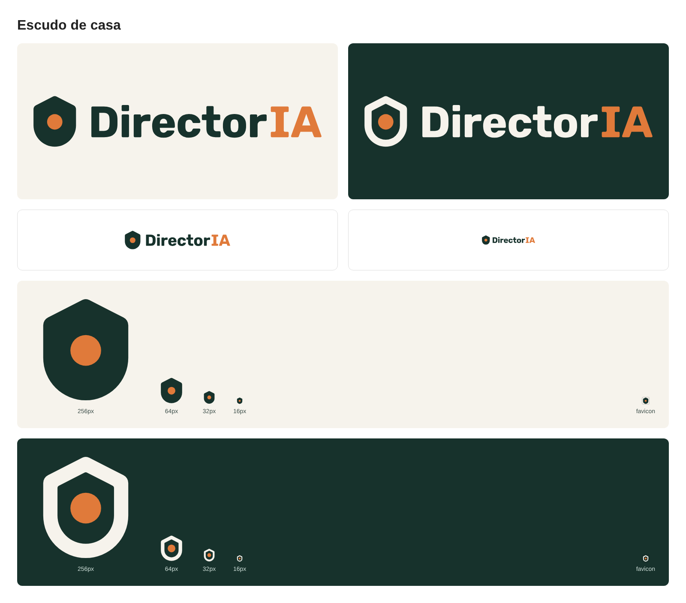

# Escudo de casa

> **Archivo.** Este concepto se exploró antes de elegir el logotipo, y sus frases no se han puesto al día. Algunas dicen que los datos del alumnado «no salen» del colegio o dan a la IA trabajo que hace DirectorIA con las reglas del colegio, como las sustituciones. Para escribir sobre DirectorIA, seguid `directoria/manual/identidad-verbal.md`.

Territorio: **escudo-cole** · Marca: **DirectorIA**

**La idea en una frase:** un escudo de colegio con tejado, mitad escudo y mitad edificio, que guarda dentro la chispa naranja: la IA vive en vuestro centro y de ahí no sale.

## Por qué encaja con DirectorIA

- **Habla el idioma de los colegios.** El escudo es el emblema de siempre de los centros, sobre todo de los concertados y los privados. Un equipo directivo de 45 a 60 años lo reconoce como algo serio e institucional. Aquí se dibuja con geometría redonda y actual, sin heráldica medieval.
- **El tejado lo convierte en el cole.** El escudo tiene forma de edificio, y «de casa» quiere decir dos cosas: el centro es vuestra casa, y lo que es de casa es de confianza. El nombre también juega con «el escudo de la casa» de la heráldica.
- **La privacidad se entiende sin explicarla.** La chispa está entera dentro del escudo y no toca el borde. Es el servidor que vive dentro del colegio, del que no salen los datos del alumnado. No hacen falta candados ni cerraduras.
- **Una IA tranquila.** La chispa es un punto en calma, no un destello. No hay robots, cerebros, circuitos ni bombillas. Y es el mismo naranja que la «IA» del nombre: la chispa del escudo *es* la IA.
- **Muy de aquí.** La base redonda y la proporción 5:6 vienen del escudo español (cuadrilongo de base redondeada).
- **Pizarra y tiza.** Sobre fondo oscuro, el escudo se perfila con un contorno de tiza, como un dibujo en la pizarra. Son los nombres de la propia paleta.

## Tipografía

- **Rubik Bold (700)**, convertida en contornos e interletrado de −1 %. Licencia SIL OFL.
- La **«I» de «IA» lleva remates**: unas serifas redondeadas, del grueso de los trazos horizontales de Rubik. Así nunca se lee «DirectorlA». Además, «IA» va en naranja y tiene un poco más de aire después de la «r».
- Nunito Sans queda para los textos que acompañan al logotipo y no aparece en él.

## Construcción

- **Isotipo (caja de 100):** escudo de 93 de alto por 77,5 de ancho (proporción 5:6). El tejado tiene una inclinación de 27° y las esquinas redondeadas (vértice de radio 7, hombros de radio 8). La base es un semicírculo.
- **Chispa:** círculo de radio 14 colocado en el centroide de la silueta, en y = 51,06.
- **Logotipo horizontal:**
  - Los hombros del escudo caen justo en la altura de las mayúsculas y la chispa en la mitad de esa altura.
  - El tejado sobresale por arriba y la base cuelga por debajo de la línea de base.
  - El aire entre el escudo y la palabra mide lo mismo que el diámetro de la chispa.
  - El margen es igual por los cuatro lados.
- **Negativo:** es el mismo escudo, con el interior en pizarra y un contorno de tiza de 13 (casi el grueso de los trazos de la palabra). La chispa queda siempre sobre pizarra, con un contraste de 4,6:1.
- **A una tinta:** escudo en pizarra con la chispa calada.
- **Tamaños mínimos:** logotipo horizontal a 24 px de alto (unos 125 px de ancho) e isotipo a 16 px.

## Color

| Versión | Escudo | Chispa | «Director» | «IA» |
|---|---|---|---|---|
| Positivo (fondo claro) | pizarra #17322C | chispa #E07A3A | pizarra #17322C | chispa #E07A3A |
| Negativo (fondo pizarra) | contorno tiza #F6F3EC, interior pizarra #17322C | chispa #E07A3A | tiza #F6F3EC | chispa #E07A3A |

En usos muy pequeños sobre fondo claro (menos de 24 px de alto), «IA» puede ir en chispa-texto #B4531C, que da 4,5:1 sobre tiza. La chispa sobre tiza solo da 2,7:1.

## No hacer

- No invertir el escudo relleno de tiza con la chispa en el centro, porque parece un huevo frito. Sobre oscuro va siempre perfilado.
- No escribir «DirectorIA» con la fuente: la I con remates solo existe en los archivos del logotipo.
- No sacar la chispa del escudo ni añadirle destellos.

## Archivos

- `isotipo.svg` e `isotipo-negativo.svg`
- `logo-horizontal.svg` y `logo-horizontal-negativo.svg`
- `tablero.png`: el logotipo en claro, en oscuro y a tamaños pequeños.
- `bocetos.png`: las variantes exploradas y por qué se descartaron.
- `build.mjs`: genera todos los SVG. Necesita `brandtools/outline.mjs`, cuya ruta se indica en la variable `BRANDTOOLS`.
