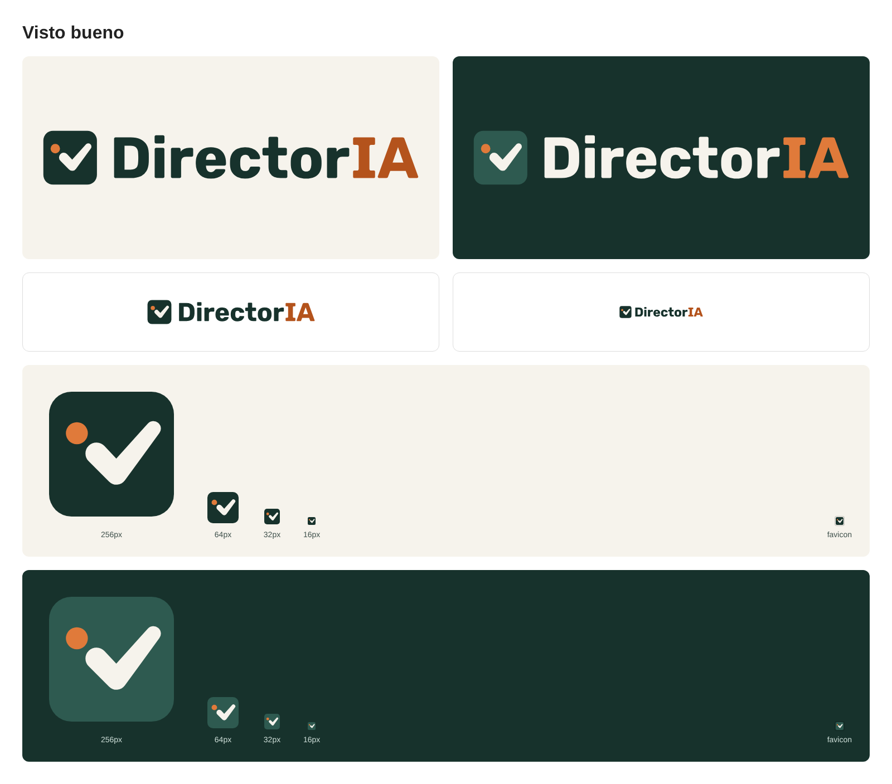

# Visto bueno

**Territorio:** pizarra · **Marca:** DirectorIA · **Tipografía del logotipo:** Rubik 700 (SIL OFL), convertida en trazos, con una I de remates dibujada a medida

**La idea en una frase:** sobre una pizarra, la chispa naranja marca el punto de partida (la IA propone) y una persona traza el visto de tiza (decide). Es el trabajo del equipo directivo, hecho y en orden.

## Por qué encaja con DirectorIA

- **El visto bueno es el gesto de la dirección.** Los certificados y documentos del centro los firma la secretaría «con el Vº Bº del director/a». El logotipo pone ese gesto en el centro: la última palabra es de una persona, no de la máquina.
- **Dibuja la promesa comercial.** La chispa es un círculo geométrico y exacto: es la IA, que deja preparado el punto de partida (la sustitución, el borrador del acta, el aviso del plazo). El visto es un trazo de mano, con el arranque firme y el final más fino, como cuando se corrige un cuaderno: es la persona, que decide. El orden de lectura, de izquierda a derecha, es el orden del producto: primero propone la IA y después decide una persona.
- **La pizarra la reconocen todas las generaciones.** No hace falta explicarla a un equipo directivo de 45 a 60 años. Además, los colores de la paleta ya llevan su nombre: pizarra, tiza y chispa. El símbolo los usa literalmente.
- **Transmite calma.** Un visto significa «hecho, en orden». No hay robots, cerebros, circuitos, bombillas ni destellos. La IA aparece como un punto discreto y del mismo naranja que la «IA» del nombre.
- **Aguanta el uso real.** A una tinta, el visto y la chispa van calados en la pizarra, así que sirve para el sello de secretaría, una fotocopia o un grabado (ver `bocetos/una-tinta/`). A 16 px la pizarra mide 14 px exactos y sus bordes caen en píxel entero, de modo que el favicon sale nítido.

## El logotipo y la «IA»

- **Palabra:** Rubik 700 convertida en trazos, con un interletrado del −0,5 %. «Director» va en pizarra (#17322C).
- **Una I que no se confunde con la l.** La I de «IA» lleva remates, como la I mayúscula que muchos escriben a mano para distinguirla de la l. El asta mide lo mismo que la I de Rubik 700 (18,5 en un cuerpo de 100). Los remates miden 2,05 veces el asta de ancho y 0,7 veces el asta de grueso. Las esquinas exteriores van redondeadas como las de Rubik y las uniones con el asta son suaves. Se lee como mayúscula también a una tinta, porque la distinción no depende del color.
- **Color de la «IA».** Sobre fondo claro va en chispa-texto (#B4531C), con un contraste de 4,5:1 sobre tiza; #E07A3A solo llegaría a 2,7:1. Sobre pizarra va en chispa (#E07A3A), con un contraste de 4,6:1. La chispa del símbolo es siempre #E07A3A, porque va sobre fondo oscuro.
- **Proporción.** La pizarra mide 1,32 veces la altura de las mayúsculas y va centrada en ella: sobresale lo mismo por arriba que por abajo. La separación entre la pizarra y el texto es 0,32 veces la pizarra.

## Construcción del símbolo

- **Pizarra:** un cuadrado de 100 × 100 con esquinas de radio 18. Es más institucional que el «squircle» de las apps y se acerca más a un encerado.
- **Visto:** el trazo corto mide 23 y va a 46°; el largo mide 47 y va a 51°. El grosor pasa de 17,6 en el arranque a 16,8 en el vértice y 12 en el final. La unión de abajo es redonda y el ángulo interior es vivo.
- **Chispa:** un círculo de 17,6 de diámetro, el mismo grosor que el arranque del visto. Va en el eje del trazo corto, a 5 unidades del visto.
- **Corrección óptica:** el grupo se desplaza +1,5 a la derecha y −1 hacia arriba, porque el vértice pesa abajo a la izquierda.
- **Negativo:** sobre fondo pizarra, la pizarra del símbolo pasa a pizarra-línea (#2E5A50). El visto sigue en tiza y la chispa en chispa.
- **Margen del isotipo:** la pizarra ocupa 14/16 de la caja, así que a 16, 32, 64 y 256 px sus bordes caen en píxel entero.

## Archivos

| Archivo | Uso |
|---|---|
| `isotipo.svg` | Símbolo sobre fondo claro |
| `isotipo-negativo.svg` | Símbolo sobre fondo pizarra |
| `logo-horizontal.svg` | Símbolo y palabra sobre fondo claro |
| `logo-horizontal-negativo.svg` | Símbolo y palabra sobre fondo pizarra |
| `tablero.png` | Tablero de evaluación |
| `bocetos/una-tinta/` | Versiones a una tinta (comprobación) |
| `bocetos/proceso.png` | Resumen de las rondas de bocetos |
| `build.mjs`, `lib.mjs` | Generan todo a partir de parámetros (texto convertido con `outline.mjs`) |

## Proceso

1. **Ronda 1 (nueve ideas):** pizarra con repisa, orden del día, cuaderno con cinta, visto de dos trazos, la tiza que hace el visto, entre otras. La pizarra con repisa se leía como un portátil. El orden del día y el cuaderno quedaban genéricos (apps de notas). El visto de dos colores recordaba a Microsoft To Do.
2. **Rondas 2 a 6:** «Vº» con su ordinal, visto a cuadros, punteado que se repasa, la tiza tumbada y la chispa en el vértice. Ganó la chispa como punto de partida del visto: es la que mejor cuenta «la IA propone y una persona decide».
3. **Rondas 8 a 10 (afinado):** una pizarra menos redonda, el visto con gesto de tiza (arranque firme, final fino), el peso del visto frente a Rubik 700 y la proporción con la palabra (la pizarra pasó de 1,42 a 1,32 veces la altura de mayúsculas). El negativo sin pizarra quedaba débil junto al nombre.
4. **Rondas 11 a 15:** intenté romper la lectura de «casilla marcada» con una pizarra apaisada y con la chispa y el visto en diagonal. La diagonal se descartó porque, a una tinta, recordaba al icono de «imagen» (un sol y una montaña). Volví al punto de partida, con el visto algo menor para que se vea más pizarra, la corrección óptica, un hueco más claro entre la chispa y el visto, y el ajuste del margen para que el favicon salga nítido.

## Puntos débiles (honestos)

- **Un visto en un cuadrado es un motivo conocido:** casillas, apps de tareas. Junto al nombre y en tamaño pequeño puede leerse como «☑ DirectorIA», y la distinción depende de la chispa y del color.
- **A 16 px la chispa es una mota naranja.** El favicon es nítido, pero lo que se ve es la pizarra con el visto: la señal de IA casi desaparece.
- **El sentido de la chispa como punto de partida hay que contarlo.** Sin explicación también se lee como la viñeta de una lista.
- **La I con remates no es exclusiva de este concepto:** otras propuestas de la exploración usan la misma solución.
- **En negativo, la pizarra-línea es un verde apagado.** El símbolo tiene menos contraste que en positivo, y la chispa sobre ese verde se queda en 2,6:1.
- **Conviven dos naranjas:** la chispa (#E07A3A) y la «IA» sobre claro (#B4531C). Es una decisión de legibilidad, pero se nota la diferencia de tono.
