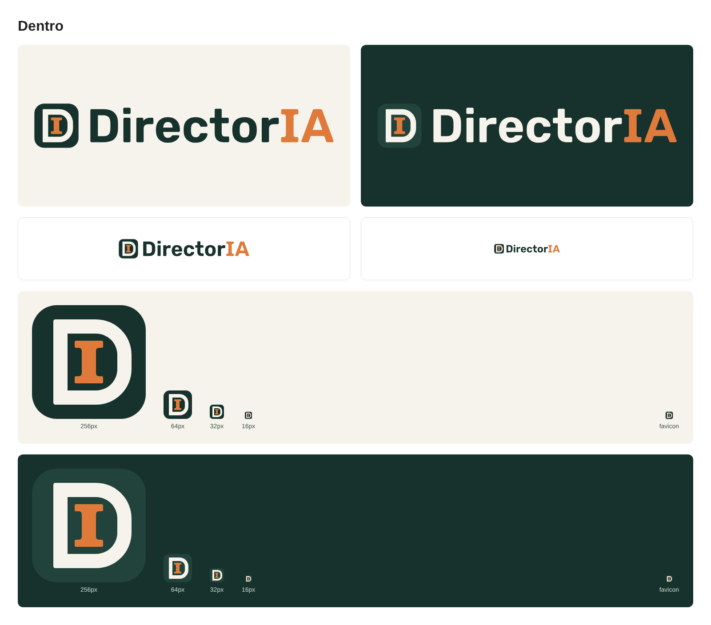

# Dentro · concepto tipográfico para DirectorIA

**La idea en una frase:** la I de «IA» lleva remates para que nunca se lea «DirectorlA», y en el símbolo esa misma I está dentro de la D, como vuestra IA está dentro del colegio.

## Por qué encaja con DirectorIA

- **La legibilidad no depende del color.** Los remates distinguen la I mayúscula de la l minúscula, igual que en las tipografías pensadas para leerse bien (Verdana, Atkinson Hyperlegible). Funciona a una tinta, en fotocopia, en un sello de secretaría y a 24 px de alto. El color (Director en pizarra, IA en naranja) refuerza la lectura, pero no la sostiene.
- **Es institucional, pero actual.** Los remates recuerdan a la letra impresa de los papeles que DirectorIA ayuda a preparar: actas, protocolos y comunicaciones oficiales. El resto de la palabra va en Rubik, la tipografía de la presentación comercial.
- **El símbolo cuenta el argumento de venta sin ilustrarlo.** La I (la IA) está dentro de la D (la dirección y el centro), porque los datos no salen del colegio. Además, el símbolo usa la paleta al pie de la letra: una ficha de pizarra, una D de tiza y una I de chispa.
- **Es tranquilo y adulto.** No hay robots, cerebros, circuitos ni destellos. Para equipos directivos de 45 a 60 años se lee como una marca seria y cercana, no como una startup de moda.
- **La IA se ve, pero no manda.** «Director» pesa más en la palabra y la IA es el acento. Es el reparto de papeles del producto: la IA propone y una persona decide.

## Tipografía

- **Logotipo:** «Director» y la «A» están en Rubik 600 (SIL OFL), convertidas a trazos. La «I» está dibujada a mano: su asta mide lo mismo que la I de Rubik 600 (16,3 en un cuerpo de 100), los remates tienen 11 de grosor y 10 de vuelo, y la unión con el asta es una pequeña cartela curva. Las esquinas son suaves, como en Rubik.
- **Símbolo:** está dibujado a mano sobre una rejilla de 32 px. La D tiene un trazo uniforme de 4 px y esquinas como la D de Rubik. La I con remates mide 12 px. Todos los bordes rectos caen en píxel entero a 16 y 32 px, así que el favicon sale nítido.
- **Textos de la marca:** Rubik en titulares (500/600/700) y Nunito Sans en el texto, como en la presentación.

## Construcción y uso

- En la versión horizontal, la D del símbolo mide exactamente la altura de las mayúsculas y comparte línea base con «DirectorIA». Entre la ficha y la palabra queda aproximadamente ¼ del ancho de la ficha.
- **Sobre fondo claro:** ficha pizarra `#17322C`, D tiza `#F6F3EC`, I del símbolo e «IA» en chispa `#E07A3A`, y «Director» en pizarra.
- **Sobre fondo pizarra:** la ficha pasa a pizarra-2 `#21433B`, que es el color de las tarjetas oscuras de la presentación, y «Director» pasa a tiza. Así el símbolo conserva su forma y no se lee «D DirectorIA».
- **A una tinta:** todo en pizarra, con la D y la I caladas. La I con remates sigue diciendo «IA» (ver `bocetos/r6/monocromo-hoja.png`).
- **Tamaños mínimos:**
  - Logotipo horizontal: 24 px de alto en pantalla, unos 7-8 mm impreso.
  - Símbolo: 16 px. A ese tamaño la I se ve como un punto naranja; se lee como I a partir de 24-32 px.
- Si el logotipo en positivo se usa muy pequeño sobre fondo claro, la «IA» puede pasar a chispa-texto `#B4531C` para ganar contraste.

## Archivos

- **SVG finales:** `isotipo.svg`, `isotipo-negativo.svg`, `logo-horizontal.svg` y `logo-horizontal-negativo.svg`. Todo es trazo, sin `<text>`, y solo usa colores de la marca.
- **Tablero de evaluación:** `tablero.png`.
- **Generador:** `build.mjs` genera los SVG finales. Necesita `brandtools/outline.mjs` para pasar Rubik a contornos.
- **Bocetos (`bocetos/`):** el proceso completo, con una carpeta por ronda.
  - `r1`: cinco caminos (I con remates, ficha «IA», chispa sobre la I, ligadura IA y peso 600 frente a 700).
  - `r2` a `r6`: refinado del monograma, de los remates, de las versiones en negativo y del tamaño de la D, con pruebas de píxel a 16, 24 y 32 px.

## Puntos débiles

- La lectura «D DirectorIA»: el símbolo es una D y la palabra empieza por D. La ficha lo suaviza, pero no lo elimina. En negativo, la ficha pizarra-2 tiene poco contraste y en un proyector puede desaparecer.
- A 16 px la I del símbolo es solo una mancha naranja. La idea de «la IA dentro» necesita 24 px o más.
- El naranja chispa sobre tiza tiene un contraste de 2,7:1. A tamaños muy pequeños la «IA» queda más clara que «Director».
- Un solo carácter con remates en una palabra sin ellos es un recurso conocido y algunas personas lo asociarán a una máquina de escribir o a una tipografía de código.
- En texto corrido, la I de Rubik o Nunito Sans sigue siendo un palo: el problema «DirectorlA» solo queda resuelto en el logotipo.
