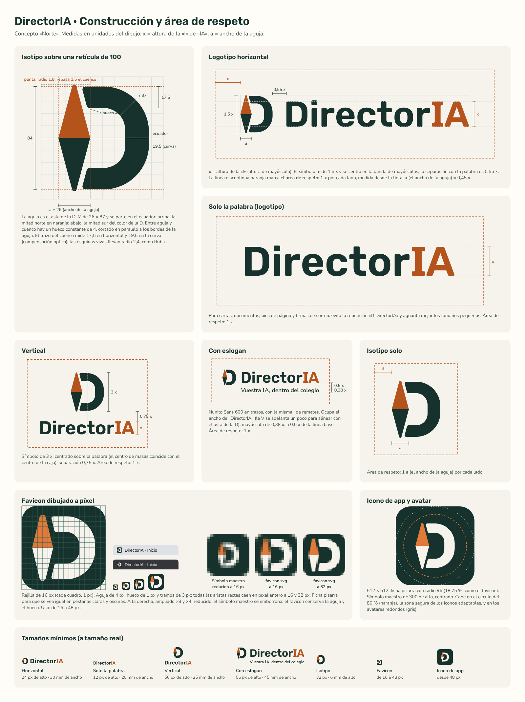
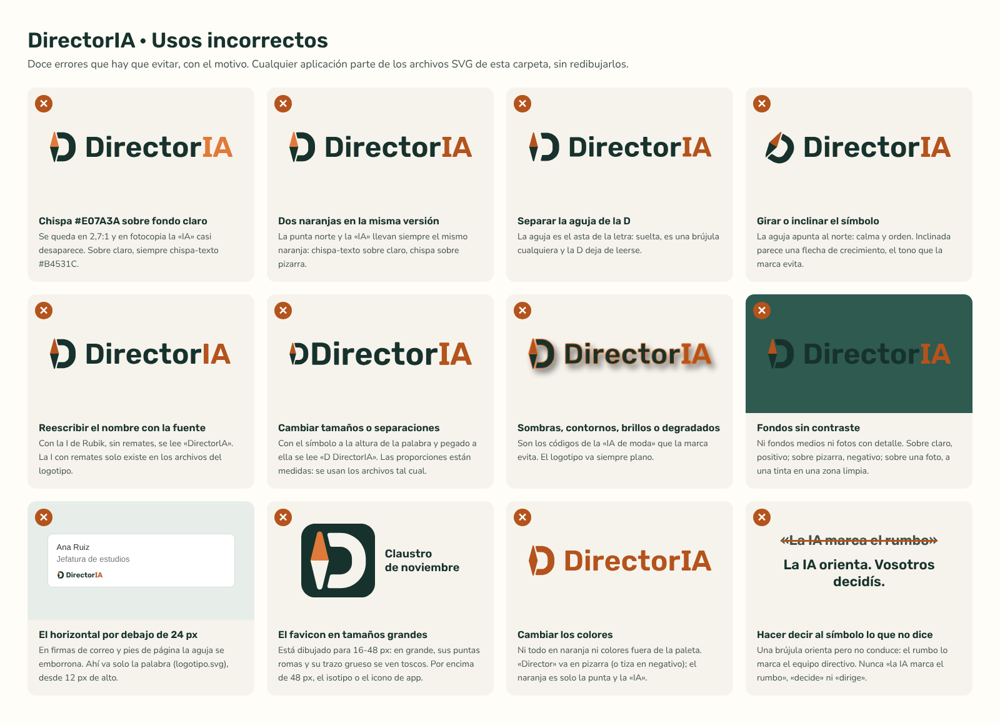

# Logotipo de DirectorIA · Construcción y uso

Sistema definitivo del logotipo de DirectorIA, a partir del concepto «Norte», el que eligió el jurado. El asta de la D es una aguja de brújula. La mitad norte, en naranja, es la IA que orienta. El cuenco, en pizarra, es el equipo directivo, que decide.



## Qué dice el símbolo y cómo contarlo

- **Dirección tiene dos sentidos.** En español, «dirección» es el equipo directivo y es también el rumbo. «No perder el norte» lo entiende cualquier director sin que nadie se lo explique.
- **Una brújula orienta, pero no conduce.** Así se cuenta el símbolo: **«La IA orienta; vosotros decidís»**. Es la versión gráfica de la segunda línea de la marca, «La IA propone. Vosotros decidís».
- **Lo que nunca se dice:** «la IA marca el rumbo», «la IA dirige» o «la IA decide». El rumbo lo marca el equipo directivo.
- **El símbolo no cuenta que el servidor está en el colegio.** Eso lo dice el eslogan, «Vuestra IA, dentro del colegio». Por eso las piezas institucionales llevan la versión con eslogan.
- **Líneas de campaña posibles** (no sustituyen al eslogan): «Un curso con norte» y «Orienta sin salir del colegio».

## Qué cambia respecto a la propuesta del concurso

Son las mejoras que pidió el jurado, aplicadas sin cambiar la idea.

1. **Favicon propio, dibujado a píxel.** El símbolo reducido a 16 px se emborronaba: quedaba una D con una esquina naranja. El favicon nuevo tiene una aguja de 4 px, un hueco de 1 px y tramos de 3 px, con todas las aristas rectas en píxel entero. Va sobre una ficha pizarra, que es donde la chispa destaca más.
2. **Puntas redondeadas (radio 1,8).** Ahora hablan el idioma blando de Rubik y dejan de parecer un filo o la punta de un lápiz. Se ha recalculado el largo de la aguja para que las puntas sigan rebasando el cuenco 1,5 unidades.
3. **I con cartela.** La unión entre el asta y los remates es curva (radio 3,5), como en la I del concepto «Dentro», la mejor dibujada de la ronda. El vuelo de los remates pasa de 7 a 7,5. Solo se ha tomado ese detalle de la letra: el símbolo sigue siendo uno.
4. **Menos «D DirectorIA».** En el horizontal, el símbolo crece de 1,4 a 1,5 veces la altura de mayúscula y se separa más de la palabra (de 0,42 a 0,55). Así se lee como emblema y no como una letra repetida.
5. **Solo la palabra.** Nueva versión para cartas, documentos, pies de página y firmas de correo, donde el horizontal queda pequeño y repite la D.
6. **Versión con eslogan.** El eslogan va en Nunito Sans 600, con la misma I de remates. Sin ella, la «IA» del eslogan también se lee «lA».
7. **Sistema completo.** Versiones a una tinta (pizarra y tiza), vertical, favicon e icono de app.
8. **Ajuste técnico.** La mitad sur de la aguja se mete 0,5 unidades bajo la norte, donde no se ve. Así, al reducir, no aparece una línea de fondo entre las dos mitades.

**Lo que se probó y no se adoptó:**

- **Rubik 700 en tamaños pequeños.** Gana algo de cuerpo por debajo de 24 px, pero obliga a tener dos dibujos distintos de la palabra. Los tamaños pequeños se resuelven con la palabra sola y con los mínimos de abajo.
- **La aguja dentro del cuenco.** Ya se exploró en los bocetos B y F de [la exploración](../exploracion/rumbo/bocetos.png). En diagonal recuerda a Safari; en vertical se acerca a «Dentro» y la D se pierde a 16 px. El «dentro» lo cuenta el eslogan.
- **El símbolo como D de «Director».** Parte la palabra en dos y exige un segundo logotipo. La palabra sola ya evita la repetición donde molesta.

## Archivos

| Archivo | Para qué |
|---|---|
| `logo-horizontal.svg` | Versión principal sobre fondos claros: web, presentaciones, dossier, señalética. |
| `logo-horizontal-negativo.svg` | La misma sobre pizarra. |
| `logo-horizontal-mono-pizarra.svg` | A una tinta oscura: fotocopia, fax, sello, grabado. |
| `logo-horizontal-mono-tiza.svg` | A una tinta clara: sobre fotos oscuras o fondos oscuros fuera de la paleta. |
| `logo-vertical.svg` · `logo-vertical-negativo.svg` | Formatos cuadrados o estrechos: portadas, carteles, lonas, perfiles. |
| `logo-eslogan.svg` · `logo-eslogan-negativo.svg` | Piezas institucionales: portada de la web, dossier, presentación comercial, carta de presentación a un colegio o a las familias, documentos para la Inspección. |
| `logotipo.svg` · `logotipo-negativo.svg` · `logotipo-mono-pizarra.svg` · `logotipo-mono-tiza.svg` | Solo la palabra: cartas, documentos, pies de página, firmas de correo, textos legales, y donde el símbolo ya está presente (app, favicon). |
| `isotipo.svg` · `isotipo-negativo.svg` · `isotipo-mono-pizarra.svg` · `isotipo-mono-tiza.svg` | El símbolo solo, desde 32 px: sello, marca de agua, cabecera de la app. |
| `favicon.svg` | Pestañas del navegador y accesos directos, de 16 a 48 px. |
| `app-icon.svg` · `png/app-icon-512.png` | Icono de la app, avatar en redes sociales e icono de acceso directo en móviles (`apple-touch-icon`). |
| `png/` | Los PNG, con fondo transparente, para el correo, las redes sociales y las versiones antiguas de Office. Ver el apartado siguiente. |
| `tablero.png` | Tablero de evaluación: positivo, negativo e isotipo de 256 a 16 px. |
| `construccion.png` · `usos-incorrectos.png` | Esquemas de este documento. |
| `build.mjs` · `outline.mjs` · `png.mjs` · `package.json` · `package-lock.json` | Generadores de los SVG (`build.mjs`, con los parámetros al principio del archivo) y de los PNG (`png.mjs`), con las versiones exactas de lo que usan. Ver «Cómo regenerar los archivos». |

Todos los SVG están en trazos, sin `<text>`, con colores planos de la paleta y un `viewBox` ajustado con un margen pequeño e igual por los cuatro lados. Ese margen no es el área de respeto. La geometría del símbolo y de la palabra es idéntica en todas las versiones. La única excepción es el favicon, que tiene un dibujo propio para tamaños de 16 a 48 px.

**SVG o PNG.** Word y PowerPoint actuales (Microsoft 365, antes Office 365, y Office 2019 o posteriores) insertan SVG. Usad el SVG, que se ve nítido a cualquier tamaño, también impreso. El PNG queda para el correo, las redes sociales, las versiones antiguas de Office y los programas que no acepten SVG. En Documentos y Presentaciones de Google, usad también el PNG.

### PNG para el correo, las redes y Office antiguo

Están en `png/` y salen de los SVG con `npm run png`. Todos tienen fondo transparente, salvo el negativo «con fondo».

| Archivo | Medidas | Para qué |
|---|---|---|
| `logotipo-firma.png` | 118 × 20 px | Firma de correo (solo la palabra), ya a su tamaño final. |
| `logotipo-firma-2x.png` | 236 × 40 px | La misma al doble, para pantallas de alta densidad. Se coloca a 118 × 20 px. |
| `logotipo-600.png` · `logo-horizontal-600.png` · `logo-eslogan-600.png` | 600 px de ancho | Correos con cabecera, boletines y web. Colocados a la mitad (300 px de ancho) se ven nítidos. |
| `logotipo-1600.png` · `logo-horizontal-1600.png` · `logo-eslogan-1600.png` | 1600 px de ancho | Documentos y presentaciones en versiones antiguas de Office, redes sociales e impresión de hasta 13,5 cm de ancho. |
| Los mismos con `-negativo` (por ejemplo, `logotipo-negativo-600.png`) | 600 y 1600 px | Tiza y chispa sobre transparente, solo para fondos pizarra o pizarra-2: diapositivas y cabeceras oscuras. |
| `logo-horizontal-negativo-fondo-1600.png` | 1600 × 506 px | El negativo con su fondo pizarra, para sitios donde no se puede poner un fondo oscuro detrás o que no admiten transparencia. |
| `app-icon-512.png` | 512 × 512 px | Icono de la app y avatar. |

- **Sin recuadro.** Con el fondo transparente, sobre una página o un correo blancos no aparece ningún recuadro alrededor del logotipo, y al imprimir no sale una mancha.
- **Área de respeto incluida.** Los de 600 y 1600 llevan 1 x de margen transparente por cada lado. Se pueden colocar sin medir, y el texto de alrededor no se acerca más de la cuenta. Por eso el logotipo ocupa unas cuatro quintas partes del ancho de la imagen: para respetar los mínimos impresos, la imagen tiene que medir al menos 37 mm de ancho con el horizontal, 26 mm con la palabra sola y 55 mm con el eslogan.
- **La firma no lleva ese margen** (solo 1 px), porque en la firma el espacio lo dan las líneas de alrededor. Con 1 x por cada lado, la palabra se quedaría por debajo de su mínimo.
- **Los negativos parecen vacíos** en un visor de imágenes con fondo blanco, porque son tinta clara sobre transparente. Se ven al ponerlos sobre pizarra.
- **Resolución anotada.** Los de 1600 llevan 300 ppp y suelen entrar en Word a 13,5 cm de ancho; los de 600 llevan 192 ppp (7,9 cm). Reducir un PNG no le quita calidad; ampliarlo, sí. Para algo más grande, el SVG.

**Firma de correo.**

1. **Solo la palabra.** El horizontal no va en la firma: ahí mediría menos de 24 px de alto.
2. **A 118 × 20 px.** Si el programa de correo deja fijar el tamaño de la imagen, usad `logotipo-firma-2x.png` a esa medida, que se ve más nítida en pantallas de alta densidad. Word y el Outlook clásico suelen insertarla ya a ese tamaño, porque lleva anotados 192 ppp. Si el programa no deja fijarlo con exactitud, como Gmail, usad `logotipo-firma.png`, que ya mide eso.
3. **Con texto alternativo y con el nombre escrito.** Si el programa lo permite, poned «DirectorIA» como texto alternativo de la imagen. En el texto de la firma, el nombre va también escrito, con la fuente y el color del resto de la firma.
4. **Modo oscuro.** Algunos programas de correo ponen un fondo oscuro detrás de las imágenes transparentes. Ahí «Director» casi desaparece y solo se ve la «IA». Le pasa a cualquier logotipo oscuro con fondo transparente, y por eso el nombre va también escrito.

## Construcción

### Isotipo (retícula de 100)

- **Cuenco.**
  - Mide 84 de alto (de 8 a 92) y su lado derecho está en 88.
  - El trazo mide 17,5 en los tramos horizontales y 19,5 en la curva. La curva es más gruesa por compensación óptica: así parece igual.
  - El radio exterior es de 37, como eco de la D de Rubik. Las esquinas vivas llevan radio 2,4, como las de Rubik.
- **Aguja.**
  - Su eje está en x = 27.
  - Mide 26 de ancho en el ecuador. Esta medida es la unidad **a**.
  - Mide 87 de alto: las puntas, de radio 1,8, rebasan el cuenco 1,5 arriba y abajo, de 6,5 a 93,5.
  - Se parte en el ecuador, en y = 50.
- **Hueco.** Entre la aguja y el cuenco hay un hueco constante de 4. Los extremos del cuenco se cortan en paralelo a los bordes de la aguja.
- **Color.** La mitad norte va en el naranja de la versión. La mitad sur va del mismo color que la D, como la mitad blanca de una brújula clásica en el negativo.
- **Caja.** El conjunto mide 74 × 87. Su centro de masas coincide con el centro de la caja (desvío del 0,2 %), así que se centra por la caja.

### Palabra

- **Tipografía.** Rubik SemiBold (600) pasada a trazos, con el interletraje de la fuente. Altura de mayúscula a cuerpo 100: **x = 70**.
- **La «I» de «IA» está dibujada a mano.**
  - El asta es la de la I de Rubik 600 (16,3 a cuerpo 100).
  - Los remates miden 10,5 de grueso y vuelan 7,5 a cada lado.
  - Las esquinas exteriores llevan radio 2,5, y la unión con el asta, una cartela de radio 3,5.
- **Espacios.** 6 entre la r y la I, y 3,5 entre la I y la A, a cuerpo 100.

### Composiciones (en múltiplos de x)

| Versión | Construcción | Proporción del archivo |
|---|---|---|
| Horizontal | Símbolo de 1,5 x de alto (con las puntas), centrado en la banda de mayúsculas; separación de 0,55 x hasta la D. En esta versión, a = 0,45 x. | 5,35 : 1 |
| Vertical | Símbolo de 3 x, centrado sobre la palabra; separación de 0,75 x. En esta versión, a = 0,9 x. | 1,5 : 1 |
| Con eslogan | El horizontal y, debajo de la palabra, el eslogan con el mismo ancho que «DirectorIA». Su mayúscula mide 0,38 x y empieza 0,5 x por debajo de la línea base. La V se adelanta un 1,2 % del ancho para alinearse ópticamente con el asta de la D. | 3,76 : 1 |
| Solo la palabra | «DirectorIA» con la I de remates. | 5,76 : 1 |

El margen interno de los archivos es de 0,12 x (4 unidades en el isotipo).

### Favicon (rejilla de 32; 2 unidades = 1 px a 16 px)

- **Ficha.** Pizarra, de 32 × 32, con radio 6.
- **Cuenco.** Va de 4 a 28 (12 px a 16 px). Los tramos y la curva miden 6 (3 px) y el radio es de 11.
- **Aguja.** Mide 8 de ancho (4 px) y su eje está en x = 8. Las puntas, de radio 1,2, quedan en 3,4 y 28,6.
- **Hueco.** Mide 2 (1 px).
- **Píxel entero.** Todas las aristas horizontales y verticales caen en píxel entero a 16 y a 32 px.
- **Colores.** Cuenco y mitad sur en tiza; punta norte en chispa.

### Icono de app

- **Ficha.** 512 × 512, pizarra, con radio 96 (18,75 %, la misma proporción que el favicon).
- **Símbolo.** Es el maestro, en negativo, de 300 de alto (58,6 %) y centrado.
- **Zona segura.** Cabe entero en el círculo del 80 %, que es la zona segura de los iconos adaptables de Android, y en los avatares redondos.

## Área de respeto

Se mide con dos unidades que se ven en el propio logotipo:

- **x**, la altura de la «I» de «IA», en las versiones con palabra;
- **a**, el ancho de la aguja en su parte más ancha, en el isotipo solo.

| Versión | Espacio libre mínimo por cada lado |
|---|---|
| Horizontal, vertical, con eslogan y solo la palabra | **1 x** |
| Isotipo solo | **1 a** |
| Favicon e icono de app | La ficha es su propia área; alrededor, lo que pida cada plataforma. |

- **Cómo se mide.** Desde la tinta, no desde el borde del archivo.
- **Qué no puede entrar.** Dentro del área no entran textos, otros logotipos, bordes de página, pliegues ni elementos de una foto.
- **Por qué esta medida.** 1 x equivale a algo más de dos anchos de aguja (2,2 a en el horizontal). Basta para que el logotipo se lea como una unidad, separado del texto y de otros logotipos, sin ocupar demasiado en pantallas pequeñas.
- **Junto al escudo de un colegio.** El escudo del colegio va primero y es mayor: DirectorIA es una herramienta del colegio y la decisión es suya. DirectorIA va como palabra sola o con eslogan, separado al menos 2 x del escudo y alineado con su base o con su centro.

## Tamaños mínimos

| Versión | En pantalla | Impreso |
|---|---|---|
| Horizontal | 24 px de alto (unos 128 px de ancho) | 30 mm de ancho |
| Solo la palabra | 12 px de alto (unos 69 px de ancho) | 20 mm de ancho |
| Vertical | 56 px de alto (unos 84 px de ancho) | 25 mm de ancho |
| Con eslogan | 56 px de alto (unos 211 px de ancho) | 45 mm de ancho |
| Isotipo | 32 px | 6 mm de alto |
| Favicon | De 16 a 48 px | No se imprime |
| Icono de app | Desde 48 px | No se imprime |

- **Medidas en pantalla.** Son de los SVG tal cual, con su margen interno pequeño. En los PNG que llevan dentro el área de respeto se mide el logotipo, sin el margen transparente.
- **Por qué esos mínimos.** En el mínimo del horizontal, los remates de la I miden 1,5 px y el hueco de la aguja, 1 px. Por debajo, la aguja se emborrona y la palabra pierde cuerpo.
- **Por debajo de 24 px de alto** (pies de página, firmas de correo, barras de navegación estrechas), no se usa el horizontal: va **solo la palabra**. En la firma de correo, `png/logotipo-firma.png` o su versión 2x.
- **Entre 16 y 31 px**, en lugar del isotipo va `favicon.svg`.
- **En sellos de caucho, grabados y bordados**, se usa la versión a una tinta con el doble del mínimo impreso: isotipo de 12 mm y horizontal de 60 mm. Así el hueco de la aguja no se cierra.

## Color

| Versión | Fondos admitidos | D, mitad sur de la aguja y «Director» | Punta norte e «IA» |
|---|---|---|---|
| Positiva (`*.svg`) | tiza `#F6F3EC`, papel `#FFFDF8`, salvia `#E7EEE9`, blanco | pizarra `#17322C` | chispa-texto `#B4531C` |
| Negativa (`*-negativo.svg`) | pizarra `#17322C`, pizarra-2 `#21433B` | tiza `#F6F3EC` | chispa `#E07A3A` |
| Una tinta oscura (`*-mono-pizarra.svg`) | Claros, fotocopia, sello | pizarra `#17322C` | pizarra `#17322C` |
| Una tinta clara (`*-mono-tiza.svg`) | Oscuros y fotos oscuras | tiza `#F6F3EC` | tiza `#F6F3EC` |
| Favicon e icono de app | Ficha pizarra `#17322C` | tiza `#F6F3EC` | chispa `#E07A3A` |

**Regla: un solo naranja por versión.** La punta de la aguja y la «IA» llevan siempre el mismo naranja: chispa-texto sobre claro y chispa sobre pizarra. Los contrastes que justifican la regla:

| Combinación | Contraste | En gris (fotocopia) |
|---|---|---|
| chispa-texto `#B4531C` sobre tiza | 4,5 : 1 (papel 4,9; salvia 4,2; blanco 5,0) | La «IA» sale en gris medio (luma 106), distinta de «Director» (41) y legible. |
| chispa `#E07A3A` sobre pizarra | 4,6 : 1 (pizarra-2: 3,6) | — |
| pizarra sobre tiza, y tiza sobre pizarra | 12,4 : 1 | — |
| **No:** chispa `#E07A3A` sobre tiza | 2,7 : 1 | La «IA» sale muy clara (luma 145) y en fotocopia casi desaparece. |
| **No:** chispa-texto `#B4531C` sobre pizarra | 2,7 : 1 | Se apaga. |
| **No:** cualquier versión sobre pizarra-línea `#2E5A50` | 1,8 : 1 (pizarra) y 2,6 : 1 (chispa) | Fondo demasiado medio. |

El kit de marca no fija equivalencias CMYK ni Pantone. Antes de la primera tirada en imprenta hay que pedir una prueba de color, y comprobar que `#B4531C` no salga marrón y que «IA» se distinga en fotocopia.

## Tipografía

- **Logotipo.** Rubik SemiBold (600), SIL Open Font License 1.1, pasada a trazos. La «I» de «IA» está dibujada a medida.
- **Eslogan.** Nunito Sans SemiBold (600), SIL OFL 1.1, pasada a trazos, con la misma I de remates (proporcional al asta de Nunito).
- **Textos que acompañan al logotipo.** Rubik en titulares (500, 600 y 700) y Nunito Sans en el texto (400, 600 y 700). Los archivos están en `directoria/fuentes/`.
- **El nombre en texto corrido.** Se escribe con la fuente del texto y del mismo color que la frase, como dice la identidad verbal. La I con remates solo existe en los archivos del logotipo. Por eso no se compone «DirectorIA» con Rubik para imitar el logo: con la I de palo se lee «DirectorlA».

## Uso correcto

- **Partir siempre de los archivos de esta carpeta**, sin redibujar ni recomponer. Las proporciones están medidas y las compensaciones ópticas no se ven a simple vista.
- **Usar el positivo sobre claro y el negativo sobre pizarra.** Para fotocopia, sello, grabado o fotos, la versión a una tinta. Es lo que garantiza el contraste.
- **Usar la palabra sola en las cartas y documentos del día a día, los pies de página y las firmas de correo.** Evita la lectura «D DirectorIA», no compite con el escudo del colegio y se lee mejor en pequeño.
- **Usar la versión con eslogan en las piezas institucionales**, también en las cartas que presentan DirectorIA a un colegio o a las familias. El símbolo habla de orientarse, no de dónde están los datos: eso lo cuenta «Vuestra IA, dentro del colegio».
- **Usar el símbolo solo donde la palabra no cabe o ya está cerca:** favicon, icono de la app, avatar, sello y marca de agua.
- **Por debajo de 32 px, usar `favicon.svg`; por encima de 48 px, el isotipo o el icono de app.** Cada dibujo está pensado para su tamaño.
- **Dejar que el colegio mande cuando aparece su escudo.** DirectorIA es su herramienta.

## Usos incorrectos



| No | Por qué |
|---|---|
| Poner chispa `#E07A3A` sobre fondo claro o chispa-texto `#B4531C` sobre pizarra. | 2,7 : 1. En fotocopia la «IA» desaparece y la I deja de distinguirse. |
| Mezclar los dos naranjas en una misma versión. | La aguja y la «IA» son la misma voz (la IA) y llevan el mismo color. |
| Separar la aguja de la D, moverla o usarla suelta junto al logotipo como segundo símbolo. | Lo propio de la marca es que la aguja sea el asta. Suelta, es una brújula cualquiera, y la D deja de leerse. |
| Girar o inclinar el símbolo. | La aguja apunta al norte: calma y orden. Inclinada parece una flecha de crecimiento o el icono de un navegador. |
| Escribir «DirectorIA» con la fuente en lugar de usar el archivo. | Sin los remates, la I se lee como una l: «DirectorlA». |
| Cambiar tamaños, separaciones o el orden del símbolo y la palabra. | Con el símbolo a la altura de la palabra o pegado a ella se lee «D DirectorIA». |
| Añadir sombras, contornos, degradados, brillos o relieve. | Son los códigos de la «IA de moda» que la marca evita. Además, se pierden en fotocopia. |
| Ponerlo sobre fondos medios o fotos con detalle. | Se pierde el contraste. Sobre una foto, a una tinta y en una zona limpia. |
| Usar el horizontal por debajo de 24 px de alto. | La aguja se emborrona. Ahí va la palabra sola. |
| Usar el favicon por encima de 48 px. | Sus puntas romas y su trazo grueso están pensados para 16 px y en grande se ven toscos. |
| Cambiar los colores o poner todo el logotipo en naranja. | El naranja es solo la IA: la punta y la «IA». |
| Escribir «la IA marca el rumbo», «la IA dirige» o «la IA decide». | Una brújula orienta pero no conduce. Decidir es cosa de personas: es un valor de la marca («Decide una persona»). |
| Usar una brújula como icono de otra cosa en la app o en los materiales, por ejemplo para Orientación. | Competiría con el símbolo y lo confundiría con el departamento de Orientación del colegio. |
| Añadir ® o ™. | La marca aún no está registrada (ver la identidad verbal). |

## Pendiente antes de cerrar la marca

1. **Búsqueda de anterioridades.** En la OEPM y la EUIPO, clases 9, 41 y 42: marcas con brújula o con «D + aguja», incluidas plataformas escolares del tipo Compass.
2. **Prueba con directores.** Una prueba de un segundo con 6 a 8 directores, con el isotipo a 32 px: ¿qué ven? Hay que descartar las lecturas «lápiz», «ID» y «departamento de Orientación».
3. **Prueba de imprenta y de fotocopia.** Comprobar el naranja `#B4531C` en papel y fijar sus equivalencias CMYK.
4. **Fuente derivada de Rubik con la I de remates.** La licencia OFL lo permite, cambiando el nombre si la fuente lo tiene reservado. Serviría para que la web, las plantillas y las presentaciones escriban el nombre igual que el logotipo.
5. **Extensiones del sistema con la aguja (no son el logotipo).**
   - El rombo bicolor puede marcar las «propuestas de la IA» en la app y en los documentos.
   - También puede servir de viñeta o de indicador de carga que oscila y se detiene, sin destellos.
   - Nunca va junto al logotipo como segundo símbolo.

## Cómo regenerar los archivos

Todo se genera en esta carpeta, con Node 18 o posterior. La primera vez, `npm ci` necesita conexión para descargar los paquetes:

```
npm ci          # instala las versiones exactas de package-lock.json
npm run build   # los 18 SVG (build.mjs)
npm run png     # los PNG de png/, a partir de los SVG (png.mjs)
```

- **`build.mjs`** genera todos los SVG a partir de los parámetros de su cabecera: el isotipo, la palabra, las composiciones, el favicon y el icono. Usa paper.js para las operaciones entre trazados y `outline.mjs`, que va a su lado y pasa Rubik y Nunito Sans a trazos con opentype.js.
- **Versiones fijas.** `package.json` y `package-lock.json` fijan paper 0.12.18, opentype.js 1.3.4, @fontsource/rubik 5.3.0 y @fontsource/nunito-sans 5.3.0 (las fuentes vienen en esos paquetes, con licencia OFL), y @resvg/resvg-js 2.6.2 para los PNG. Con ellas, `npm run build` devuelve los 18 SVG idénticos byte a byte; se ha comprobado en una instalación limpia, con Node 18 y con Node 22. Con otras versiones de las fuentes, los trazos podrían cambiar.
- **Si falta algo**, el script dice qué falta y cómo instalarlo, y se para. Si hay instalada otra versión, avisa.
- **`png.mjs`** saca el juego completo de `png/`. También sirve para un PNG suelto de cualquier SVG, con el área de respeto como margen: `node png.mjs logo-vertical.svg --ancho 1600`. La opción `--sin-margen` lo quita y `--fondo "#17322C"` pone fondo.
- `node_modules/` no se sube al repositorio.
- `tablero.png`, `construccion.png` y `usos-incorrectos.png` son láminas de este documento y se hicieron aparte.
